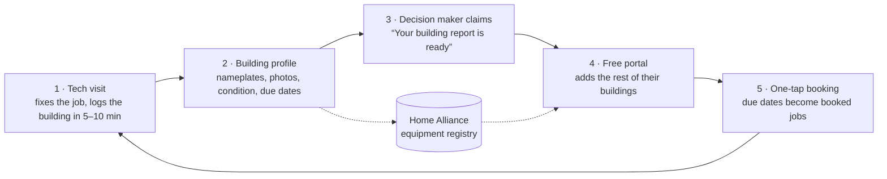

# Commercial Outreach Studio

> A pilot tool for **Home Alliance** to turn technician visits at commercial buildings into decision-maker leads.
> The lead magnet is a free maintenance hub (the Prisma commercial pilot), filled in by our techs and claimed by the building's decision maker.

  -2fe07a)

---

## Contents

- [What it does](#what-it-does)
- [The idea in one loop](#the-idea-in-one-loop)
- [Market at a glance](#market-at-a-glance)
- [Who decides](#who-decides)
- [Rollout plan](#rollout-plan)
- [Pilot KPIs](#pilot-kpis)
- [Run locally](#run-locally)
- [Deploy to Vercel](#deploy-to-vercel)
- [Project structure](#project-structure)
- [How the lead score works](#how-the-lead-score-works)
- [Limits and next steps](#limits-and-next-steps)
- [Sources](#sources)

---

## What it does

| Tab | Purpose |
| --- | --- |
| 📋 **The plan** | One-screen summary: verdict, market numbers, the 5-step loop, who decides, rollout gates and target segments. |
| 🎯 **Decision makers** | Pipeline board (Identified → Contacted → Talking → Portal claimed → Won). Scores each contact 0–100, flags influencers who aren't the buyer and adds the real decision maker in one click. Filters, overdue follow-ups and CSV export. |
| ✉️ **Messages** | Message builder for 5 channels × 5 touches: tech leave-behind text, email, LinkedIn, call script and "find the decision maker". Fills in name, building, equipment and service month. **Log as sent** moves the contact forward and schedules the next touch. |
| 📈 **Funnel** | Sliders for a 90-day, one-metro pilot: visits → profiles → claimed portals → repeat jobs → preventive plans, with revenue and go/no-go gates. |
| 🏢 **Tool** | The full Prisma commercial pilot (portfolio, rent roll, 3D building, technician booking), embedded to demo the free hub to prospects. |

---

## The idea in one loop



**Verdict:** a good lead magnet, **if we keep it maintenance-only.** Leasing and finance screens are out of scope for prospects. They already use Yardi or AppFolio and won't trust a home-services brand with financial data.

---

## Market at a glance

| Metric | Value | Source |
| --- | --- | --- |
| US commercial buildings | **5.9 million** (96 billion sq ft) | EIA CBECS 2018 |
| Share under 10,000 sq ft | **71%** | EIA CBECS 2018, Table B4 |
| Small leased buildings (≤ 25,000 sq ft, private) | **1.36 million** | EIA CBECS 2018, Table B6 |
| Owner-occupied small buildings (≤ 25,000 sq ft) | **2.91 million** | EIA CBECS 2018, Table B6 |
| Property-management businesses | **~335,000** (~66,000 commercial-only, secondary source) | IBISWorld 2025 |

> CBECS 2018 is the latest published federal survey of commercial buildings.

---

## Who decides

| Role | Buyer? | How to work it |
| --- | --- | --- |
| 👑 Building owner | ✅ Yes | Signs off on vendors and capital spend. |
| 🗂️ Portfolio / regional maintenance manager | ✅ Yes | Sets the approved-vendor list across many sites. Best target in PM firms. |
| 🏢 Property manager | ✅ Yes | Picks vendors day to day for their buildings. |
| 🧰 Facilities coordinator | ⚠️ Influencer | Books jobs. Ask who approves vendors. |
| 🙋 Tenant / on-site staff | ❌ No | Get the manager's contact and move on. |

**Target order:** (1) landlords and PMs we already serve and small leased buildings · (2) owner-occupied small businesses · (3) restaurants · skip Class A and large industrial for now.

---

## Rollout plan

| Phase | Weeks | What happens | Gate to move on |
| --- | --- | --- | --- |
| Build the minimum | 0–6 | Tech capture step, hosted portal, claim link, consent terms | 20 profiles in under 10 min each |
| Warm pilot | 7–12 | Techs profile every commercial or landlord site they visit | ≥ 30% of profiles claimed |
| Add outbound | 13–20 | PM-firm sequences, IREM/BOMA chapters, webinar, free audit | Cost per claimed building on target |
| Scale | 21+ | Second metro and a paid preventive-maintenance plan | — |

---

## Pilot KPIs

All targets are **hypotheses** to test in the pilot.

| KPI | Target |
| --- | --- |
| Minutes per building profile | ≤ 10 |
| Profile completion | ≥ 75% of eligible visits |
| Portal claim rate | ≥ 30% of profiles |
| Buildings per claimed account | ≥ 1.5 |
| Second job within 90 days | ≥ 40% of claimed accounts |
| Preventive-plan attach | ≥ 15% of claimed accounts |

---

## Run locally

No build step: it's two static HTML files.

```bash
git clone https://github.com/<your-org>/commercial-outreach-studio.git
cd commercial-outreach-studio
npx serve .
# or: python3 -m http.server 8080
```

Open the address it prints. Serve it over HTTP rather than double-clicking `index.html`, so the **Tool** tab can load `tool.html` and the 3D building works.

> Needs internet access: fonts load from Google Fonts and the 3D library (three.js) from the jsDelivr CDN.

---

## Deploy to Vercel

1. Push this folder to a GitHub repository.
2. In Vercel, **Add New → Project** and import the repo.
3. Framework preset: **Other**. Leave the build command empty and the output directory as the repo root.
4. Deploy.

GitHub Pages works too: **Settings → Pages → Deploy from branch → `main` / root**.

---

## Project structure

```text
commercial-outreach-studio/
├── index.html    # Outreach Studio: plan, pipeline, messages, funnel, Tool tab
├── tool.html     # Prisma commercial pilot, bundled into one file (embedded in the Tool tab)
├── vercel.json   # Static hosting settings
├── .gitignore
└── README.md
```

---

## How the lead score works

`score = role + segment + buildings + source`, capped at 100.

| Factor | Points |
| --- | --- |
| Role | Owner 30 · Portfolio manager 30 · Regional maintenance mgr 28 · Property manager 20 · Facilities coordinator 8 · Tenant 0 |
| Segment | Existing HA customer 25 · Small leased building 22 · Owner-occupied business 15 · Restaurant 10 · Large / Class A 0 |
| Buildings managed | 5 per building, up to 25 |
| Source | Tech visit 20 · Referral 15 · IREM/BOMA chapter 10 · Webinar 10 · Outbound 5 |

**Hot** ≥ 70 · **Warm** 45–69 · **Cold** < 45. The weights are a starting point. Tune them in `index.html` (`ROLES`, `SEGS`, `SOURCES`).

---

## Limits and next steps

- **Example data only.** All contacts and properties are fictional. Don't enter real customer data yet.
- **Data is saved in each browser** (`localStorage`). Teammates don't share a pipeline. Connect a backend or CRM before rollout.
- **Placeholders to replace:** `[claim link]`, `[booking link]`, `[Your name]`, `[number]`, plus the $450 average job and $1,200/year plan values in the Funnel tab.
- **Before Phase 2:** pull current landlord/PM customers from the CRM, count non-residential jobs by metro, and review commercial licensing and insurance limits per state.

---

## Sources

- [EIA 2018 CBECS, Table B4: buildings by division, size and activity](https://www.eia.gov/consumption/commercial/data/2018/bc/html/b4.php)
- [EIA 2018 CBECS, Table B6: buildings by size and ownership](https://www.eia.gov/consumption/commercial/data/2018/bc/html/b6.php)
- [EIA: commercial buildings overview](https://www.eia.gov/energyexplained/use-of-energy/commercial-buildings.php)
- [IBISWorld: property management businesses in the US, 2025](https://img3.ibisworld.com/united-states/number-of-businesses/property-management/1356)
- [iPropertyManagement: commercial property management statistics (secondary)](https://ipropertymanagement.com/research/property-management-industry-statistics)

---

<sub>Internal pilot · Home Alliance Marketing · example data</sub>
