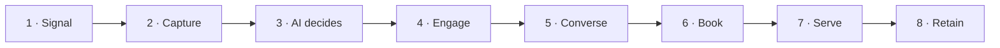
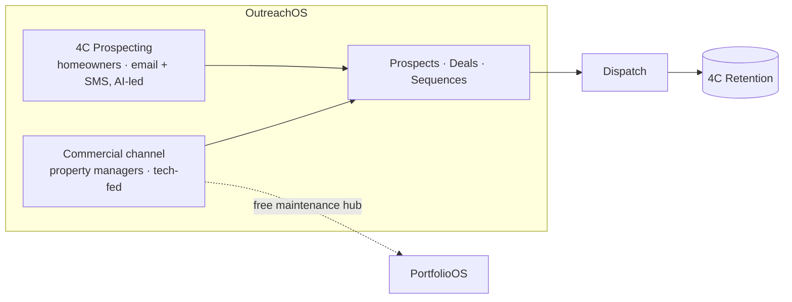

# Home Alliance OS

> **OutreachOS + PortfolioOS** in one pilot web app for Home Alliance's 4C Retention Ecosystem.
> One self-contained `index.html`, no build step, example data only.

  -13a05a)

---

## Contents

- [The two products](#the-two-products)
- [OutreachOS](#outreachos)
- [AI-Outreach automation map](#ai-outreach-automation-map)
- [PortfolioOS](#portfolioos)
- [How it fits together](#how-it-fits-together)
- [Intent model](#intent-model)
- [Run locally](#run-locally)
- [Deploy](#deploy)
- [Limits](#limits)
- [Sources](#sources)

---

## The two products

Switch between them with the bar at the top of the app.

| Product | What it is | Direct link |
| --- | --- | --- |
| 🎯 **OutreachOS** | Intent-driven prospecting CRM: 4C Prospecting (homeowners) and the commercial partner channel | `index.html#outreachos` |
| 🏢 **PortfolioOS** | Prisma commercial portfolio pilot: 5 assets with live 3D, leasing, rent roll and maintenance booking | `index.html#portfolioos` |

---

## OutreachOS

| Tab | What it does |
| --- | --- |
| 🏠 **Home** | Today's buying signals: surge feed, next best actions, weighted pipeline, intent by topic. |
| 🔎 **Advanced Search** | Database search. Filter groups (Contacts, Companies, Locations, Sales signals, Intent, Engagement, Exclude exported), 7 saved searches, quick filters (In my target accounts, Recommended lists, Likely to engage), removable filter chips, Contacts / Companies / Homeowners tabs, contact accuracy grades, bulk Export (CSV, HubSpot, ServiceTitan, Customer.io, Salesforce, Excel), Enroll, Tag, Add signal, pagination. |
| 📈 **Accounts** | Account dashboard: Top / All accounts, Hot-Warm-Cold temperature, recommended action, engagement curve with signal dots (7 / 30 / 90 days), buying stage, latest status, star. |
| 🌐 **Intent** | Website-visitor view: time, page-intent and visitor filters, visitors by portfolio size, segments, locations table, US tile map, visitor list, save as list. |
| ⚡ **Signals** | Feed of every buying signal; create alerts (record type, metro, minimum intent, signal types) with a bell count; add a signal to any record and its intent score updates instantly. |
| 🤖 **AI-Outreach** | Animated end-to-end automation map across every channel (see below). |
| 💼 **Deals** | Drag-and-drop boards for the commercial and homeowner pipelines, with values and weighted totals. |
| ✉️ **Sequences** | 8 cadences (5 homeowner, 3 commercial) with merged previews and SMS character counts; SMS sequences skip anyone without consent. |
| 🗓️ **Dispatch** | Board by technician and arrival window (8–11, 11–2, 2–5, 5–8). Same-day booking only before 12 PM. |
| 📊 **Reports** | Rank sources, segments, metros, signals, owners or fit grades by booked rate, revenue per lead, value, intent or contact rate. |
| 📘 **Playbook** | Channel model, intent weights, consent rules, CRM stack, 90-day plan and KPIs. |

Every record page shows intent, fit and value scores, a "why this score" breakdown, the buying committee (decision maker / influencer / gatekeeper), an activity timeline, locations and equipment with age flags, and actions: call, email, SMS (consent-gated), note, add signal, enroll, book job.

---

## AI-Outreach automation map



**11 channel lanes:** AI agent + CRM · SMS · Email · Calls / AI voice · Web chat · Platform inbox · Direct mail · Paid social · LinkedIn / B2B email · Tech visit / portal · Dispatch / 4C Retention.

**7 animated journeys** (play, pause, step, 0.5–2× speed, live log):

| Journey | Lane | What happens |
| --- | --- | --- |
| Web form lead | B2C | AI text in 30 s, qualifies brand + ZIP, books in 2 min |
| Missed call | B2C | Text-back, ask for consent before any offers, CSR callback at 10 min |
| Marketplace lead | B2C | First platform reply in 1 min, CSR call by 5 min |
| New mover (no consent) | B2C | Postcard → matched ads → QR to chat → SMS only after opt-in |
| Commercial tech visit → portal | Commercial | Building report → find the decision maker → portal claimed → preventive plan |
| PM firm outbound | Commercial | Intent surge → LinkedIn + email + retargeting → call → free walk-through |
| Guardrails | Both | STOP ends SMS instantly; safety words (gas, sparks, flooding) stop the AI and page a person |

**Channel rules the AI follows**

| Channel | Gate | Cap / timing |
| --- | --- | --- |
| SMS | Written consent per brand | 9 AM–8 PM recipient time, max 3 a day |
| Email | Opt-in (B2C), CAN-SPAM (B2B) | 1 a day, sunset after 60 days silent |
| Calls / AI voice | DNC scrub; AI voice needs consent | Speed window 5 min |
| LinkedIn / B2B email | Business contacts only | 5 touches over 16 days |
| Direct mail / paid social | Deliverable address / ad-match eligible | Monthly / frequency cap |

---

## PortfolioOS

Prisma commercial portfolio pilot for owners and asset managers.

| Asset | City | Type | 3D site |
| --- | --- | --- | --- |
| Prisma Bayfront | Miami, FL | Mixed-use | Class A office tower over street retail |
| Harbor Point Office Park | San Diego, CA | Office | 3 two-story glass buildings + parking |
| Maple Ridge Shopping Center | Austin, TX | Retail | Grocery anchor + 22 shops, signs per tenant |
| Lexington Logistics Center | Chicago, IL | Industrial | 4 warehouses, dock doors, truck court |
| Cedar Commons | Denver, CO | Mixed-use | Street retail with offices above |

- **Portfolio:** estimated value, NOI, cap rate, % leased, annual base rent, WALT, expirations, past-due AR, collections.
- **3D sites:** drag to orbit, hover a space for tenant, size, lease end and arrears; click to open it. Colors follow the stacking-plan mode (occupancy, lease expiry, arrears, work orders).
- **Leases:** rent roll, expiration schedule, renewal outreach, vacancy marketing, rent reminders.
- **Maintenance:** technician booking for commercial trades (HVAC/RTUs, dock doors, storefronts, parking lots, roofing, fire/life safety and more), with emergency, same-day, scheduled, recurring, virtual or bid options and CAM / capital / chargeback billing.

---

## How it fits together



| | 4C Prospecting (B2C) | Commercial (B2B2C partner channel) |
| --- | --- | --- |
| Who | Homeowners | Property managers, landlords, HOAs, small businesses |
| Rule | Consented leads only; no cold texts to consumers | Cold outreach only to business contacts (CAN-SPAM) |
| North-star KPI | Time to first touch < 60 s | Portal claim rate ≥ 30% |

---

## Intent model

`intent = Σ (signal weight × recency)`, capped at 100. Recency: ≤ 7 days 100%, ≤ 30 days 60%, ≤ 90 days 30%, older 10%. **Surge** = intent ≥ 55 with a signal in the last 7 days.

| Signal | Weight | Signal | Weight |
| --- | --- | --- | --- |
| Quote form / LSA inquiry | 38 | New mover / new owner | 18 |
| Missed or inbound call | 32 | Equipment age trigger | 16 |
| Viewed building report | 26 | Pre-mover listing | 14 |
| Pricing page visits | 24 | Competitor permit filed | 12 |
| Tech visit logged | 22 | Hiring facilities staff | 12 |
| Attended webinar | 20 | Email click | 10 |
| Vendor complaint / review | 18 | Weather event in ZIP | 10 |

Weights are a starting point; recalibrate after 90 days with the Reports "intent band vs booked" table.

---

## Run locally

```bash
git clone https://github.com/<your-account>/home-alliance-os.git
cd home-alliance-os
npx serve .
# or: python3 -m http.server 8080
```

Open the printed address. Serve it over HTTP rather than double-clicking the file so the 3D views load. Internet access is needed for fonts and the three.js library (jsDelivr CDN).

## Deploy

**Vercel:** Add New → Project → import the repo → Framework preset **Other**, no build command, root as output → Deploy.

**GitHub Pages:** Settings → Pages → Deploy from branch → `main` / root.

## Project structure

```text
home-alliance-os/
├── index.html    # Both products in one self-contained file
├── vercel.json   # Static hosting settings
├── .gitignore
└── README.md
```

---

## Limits

- **Example data only.** All people, companies, properties and numbers are fictional. Don't enter real customer data.
- **Saved per browser** (`localStorage`). Use Reset demo to start over. Team use needs a shared back end or a real CRM.
- **No live connections.** Export to HubSpot, ServiceTitan, Customer.io or Salesforce only marks records as exported; CSV export creates a real file.
- **Website visitors** are matched only from form fills, portal logins and email clicks; anonymous company matching needs a data vendor.
- Sequence rates, timings and the 42 s first-touch figure are placeholders.
- Compliance notes are a planning summary, not legal advice; have counsel review consent wording and state rules before launch.

## Sources

- [EIA 2018 CBECS, Table B4](https://www.eia.gov/consumption/commercial/data/2018/bc/html/b4.php) · [Table B6](https://www.eia.gov/consumption/commercial/data/2018/bc/html/b6.php)
- [IBISWorld: property management businesses in the US, 2025](https://img3.ibisworld.com/united-states/number-of-businesses/property-management/1356)
- [ServiceTitan Speed to Lead](https://help.servicetitan.com/release-hub/docs/convert-new-leads-into-booked-jobs-faster-with-speed-to-lead)
- [MoFo: 11th Circuit vacates the one-to-one consent rule](https://mofo.com/resources/insights/250130-eleventh-circuit-vacates-fcc-s-tcpa-one-to-one-consent-rule)

---

<sub>Internal pilot · Home Alliance Marketing · 4C Retention Ecosystem · example data</sub>
